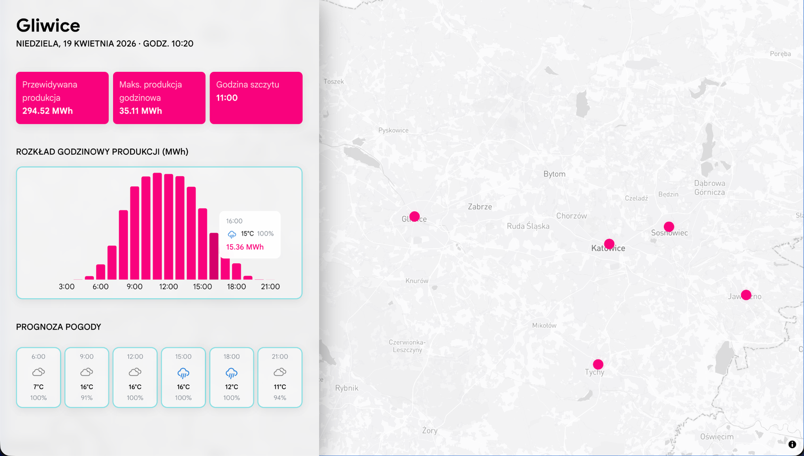
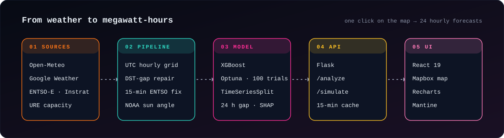
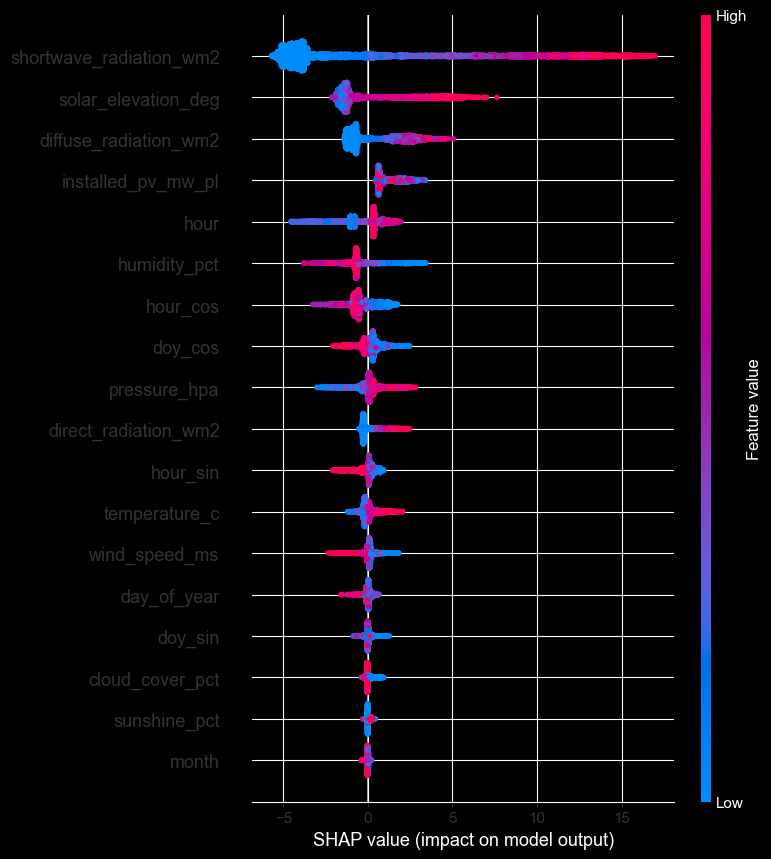

<picture>
  <source media="(prefers-color-scheme: dark)" srcset="./docs/assets/header-dark.svg">
  <source media="(prefers-color-scheme: light)" srcset="./docs/assets/header-light.svg">
  
</picture>

<p align="center">
  <a href="https://youtu.be/C_B6lFZmzMw"></a>
  
  <a href="LICENSE"></a>
</p>

<p align="center">
  
  
  
  
  
  
  
  
</p>

```text
$ solarsight --city gliwice --horizon 24h
[ 06:00 ] ▁           cloudy · 7°C
[ 09:00 ] ▅           cloudy · 16°C
[ 11:00 ] █  ← peak   35.11 MWh
[ 16:00 ] ▃           rain · 15°C · 15.36 MWh
[ Σ 24h ] 294.52 MWh  → plan conventional units, not guesses
```

**SolarSight predicts hourly photovoltaic output for the next 24 hours** in ten Silesian cities. It combines weather forecasts with three years of national PV production data. The target users are distribution-grid operators: knowing tomorrow's solar curve lets them schedule conventional units, absorb surpluses and deficits, and cut avoidable CO₂.

Built in one hackathon weekend at **ETHSilesia 2026** for the **Tauron AI Challenge**.

## 🖥️ The dashboard

<p align="center">
  
</p>

Click a city on the map to get the full forecast in one panel: total predicted production, the hourly peak and when it happens, an hourly bar chart, and a weather strip. Hovering a bar shows the weather the model saw for that hour.

## 🛰️ How it works

<picture>
  <source media="(prefers-color-scheme: dark)" srcset="./docs/assets/pipeline-dark.svg">
  <source media="(prefers-color-scheme: light)" srcset="./docs/assets/pipeline-light.svg">
  
</picture>

1. **Sources.** Hourly weather comes from the Open-Meteo archive and forecast APIs plus Google Weather. National PV generation comes from ENTSO-E via the Instrat energy API. Monthly installed PV capacity comes from URE.
2. **Pipeline.** Weather and production are joined on a full UTC hourly grid. Features include cyclic hour and day-of-year encodings and the sun's elevation from the NOAA formula.
3. **Model.** An XGBoost regressor tuned by Optuna and validated with walk-forward splits.
4. **API.** Flask serves `/analyze` (24-hour forecast) and `/simulate` (what-if cloud cover).
5. **UI.** React 19 + Mapbox GL. One click on a city triggers one request and returns 24 hourly forecasts.

## 🔍 The interesting bits

**📈 Teaching physics, not a trend line.** Polish PV capacity grew from ~12.7 GW to ~22.5 GW (+77%) between January 2023 and December 2025. Trained on raw production, a model would mostly learn that later dates mean more energy. Feeding **installed capacity as a feature** lets it learn the weather-to-efficiency relationship instead, and SHAP ranks capacity as the 4th most important feature.

**⏱️ The 13 June 2024 trap.** On that day ENTSO-E switched Polish PV reporting from 60-minute to 15-minute resolution. Summing the 15-minute values naively silently quadruples every hour after the switch. The pipeline detects the cut-over and rescales by ×0.25. The team verified this empirically against the API.

**🕐 DST-proof time axis.** Everything is joined on a complete UTC hourly grid, so the spring-forward hour can't open a hole in the data. The one missing PV hour falls at night and is filled with a physically correct zero.

**🧪 Honest validation.** Hyperparameters were tuned with **Optuna** (100 trials), each scored by **5-fold `TimeSeriesSplit`** with 30-day test windows and a **24-hour gap** between train and test. The model never peeks at tomorrow.

**🚫 Lag-free on purpose.** An earlier variant with lagged production features reported R² 0.987. Those lags don't exist when you forecast 24 hours ahead from weather alone, so the deployed model (`models/pv_xgb_no_lags.joblib`) drops them and takes the honest hit:

| Deployed model · chronological 80/20 hold-out | |
|---|---|
| MAE | **2.56 MWh** |
| RMSE | **5.85 MWh** |
| R² | **0.845** |

**☁️ Clouds barely matter (directly).** In the SHAP analysis shortwave radiation dominates, followed by solar elevation and diffuse radiation. `cloud_cover_pct` lands near the bottom, because the radiation forecasts already carry the cloud information.

<details>
<summary><b>SHAP summary plot</b></summary>
<p align="center"></p>
</details>

**🎛️ What-if that respects physics.** `/simulate` overrides cloud cover (0–100%) and rescales shortwave and direct radiation with a linear attenuation model (up to −75% at full overcast). Changing the cloud cover therefore doesn't produce a forecast that contradicts the radiation inputs.

**⚡ Production touches.**
- The model is preloaded at startup, so the first request doesn't pay for `joblib.load()`.
- Weather is cached for 15 minutes, so repeated what-if requests don't hammer Open-Meteo.
- Night hours are clamped to zero and negative predictions are clipped.
- Errors are separated: 400 for bad input, 502 for an upstream weather API failure, 500 for anything else.

## 🌍 Coverage

Gliwice · Katowice · Kraków · Wrocław · Opole · Częstochowa · Sosnowiec · Bielsko-Biała · Tychy · Jaworzno

National production is scaled to city level by population share. To add a city, append one row (`name, lat, lon, population`) to `data/cities.csv` (and a marker to `frontend/src/data/cities.json`).

## 🚀 Run it

```bash
pip install -e .            # installs the solarsight package and its dependencies

# backend → http://localhost:5001
python backend/app.py

# frontend (needs a Mapbox token)
cd frontend
cp .env.example .env        # set VITE_MAPBOX_ACCESS_TOKEN
npm install && npm run dev
```

```bash
curl -X POST localhost:5001/analyze  -H "Content-Type: application/json" -d '{"city": "Katowice"}'
curl -X POST localhost:5001/simulate -H "Content-Type: application/json" -d '{"city": "Gliwice", "cloud_cover": 100}'
```

More requests, including the error cases, are in [`backend/api_requests.http`](backend/api_requests.http). Rebuilding the dataset, retraining and the forecast pipeline are described in the [technical notes](docs/technical_notes.md).

## 🗂️ Repository

```
solarsight/                 Python package
├── config.py               paths and constants
├── geo.py                  city registry, solar elevation (NOAA)
├── features.py             cyclic time features
├── capacity.py             installed PV capacity in Poland
├── ingest/                 training data: weather history, PV production, dataset builder
├── forecast/               forecast inputs: Open-Meteo, Google Weather, merge
└── inference.py            predict() and simulate() used by the API
backend/                    Flask API + REST request collection
frontend/                   React + Mapbox dashboard
data/                       cities.csv, processed/ training dataset
models/                     trained XGBoost model
notebooks/                  01_eda · 02_train_model · 03_prediction_check
docs/                       technical notes, README assets
SolarSight.pptx             pitch deck
```

## 📡 Data sources

All data sources are public and free. Google Weather requires an API key.

[Open-Meteo](https://open-meteo.com) · [ENTSO-E Transparency](https://transparency.entsoe.eu) via [Instrat](https://energy-api.instrat.pl) · [URE](https://www.ure.gov.pl) · [Google Weather API](https://developers.google.com/maps/documentation/weather)

## 👥 Team SolarSight

Jakub Bodzioch · Kajetan Hołdan · Igor Kotlarz · Kamil Musioł · Jan Piechota · Łukasz Wolf

Licensed under [GPL-3.0](LICENSE).
